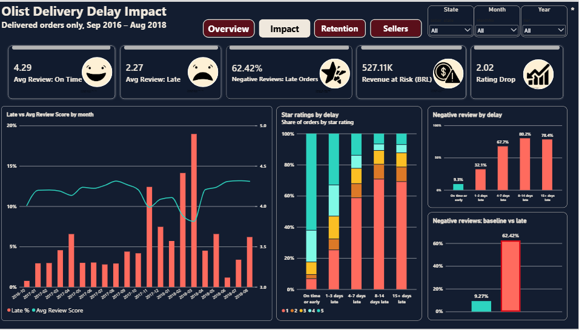
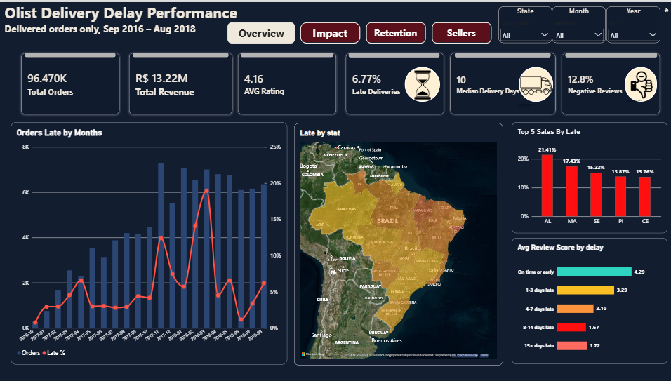
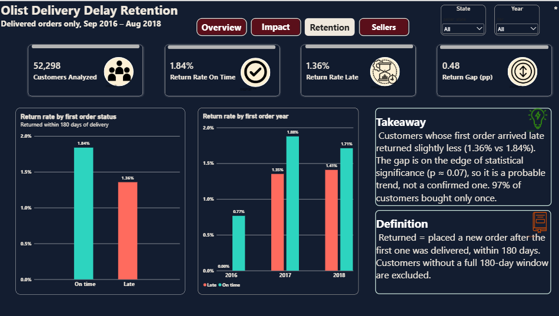
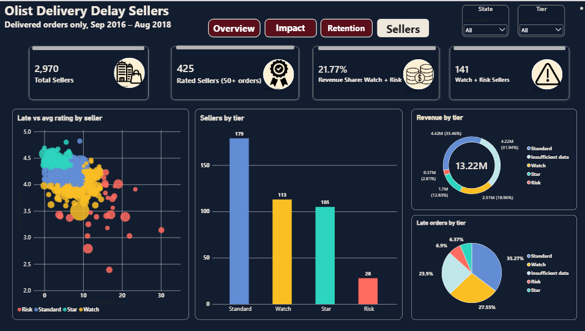
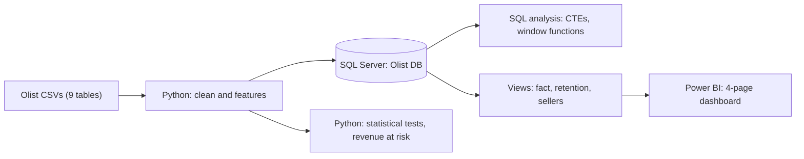

# Olist Delivery Delay Analysis

**What does a late delivery actually cost?** An end-to-end analysis of 96,470 delivered orders from a Brazilian e-commerce marketplace, built with **Python, SQL Server and Power BI**.



---

## TL;DR: key findings

| | Finding |
|---|---|
| 1 | **6.8%** of delivered orders (6,534) arrive after the promised date. |
| 2 | Late orders average **2.27 stars** vs **4.29** for on-time orders (a drop of 2.02 stars). Negative reviews (1 to 2 stars) rise from **9.3% to 62.4%**. |
| 3 | The damage happens early: **1 to 3 days late already costs a full star** (4.29 to 3.29). After about a week, ratings bottom out near 1.7. |
| 4 | About **R$527K (4.0% of reviewed revenue)** is tied to negative reviews that delays most likely caused. Sensitivity range: R$420K to R$530K. |
| 5 | Late rates are geographic: **9% to 21% in Northeast states** vs **4.5% in São Paulo**. SP and RJ together hold **51% of all late orders**. |
| 6 | Customers whose first order was late came back slightly less (**1.36% vs 1.84%**), but the gap is borderline (**p ≈ 0.07**). A possible signal, not a conclusion. |
| 7 | **141 sellers** sit in the Watch or Risk tiers and generate **21.8% of revenue**. |

> Everything here is observational. These are associations, not proof of causation (see [Limitations](#assumptions-and-limitations)).

---

## Business questions

1. How often are orders late, and when and where does it happen?
2. How much does lateness hurt customer reviews and revenue?
3. Which sellers combine high revenue with poor delivery or satisfaction?
4. Does a late first order reduce the chance that a customer comes back?

---

## Dashboard (Power BI, 4 pages)

### Overview


Headline KPIs, late rate by month, late rate by state (map and top 5), and review score by delay bucket.

### Impact


Review score and negative-review share by delay bucket, baseline vs late comparison, and revenue at risk.

### Retention


Return rate within 180 days of the first delivery, split by whether the first order was late.

### Sellers


Seller scorecard: tiers (Star, Standard, Watch, Risk, Insufficient data), revenue by tier and late vs rating by seller.

Every page has State, Month and Year filters (Sellers: State and Tier).

---

## Insights in detail

### 1. Delay and customer satisfaction

| Delivery vs promise | Orders | Avg review | Negative (1 to 2 stars) |
|---|---:|---:|---:|
| On time or early | 89,443 | 4.29 | 9.3% |
| 1 to 3 days late | 1,852 | 3.29 | 32.1% |
| 4 to 7 days late | 1,748 | 2.10 | 67.7% |
| 8 to 14 days late | 1,446 | 1.67 | 80.2% |
| 15+ days late | 1,335 | 1.72 | 78.4% |

- The median review of a late order is **1 star**.
- Pick one late and one on-time order at random: the late one has the higher rating only **18%** of the time.
- The effect is steep in the first week and flat afterwards (a floor effect). **Preventing the first days of delay matters more than shaving long delays.**

### 2. Revenue at risk

Counting every late order with a bad review would overstate the impact, because **9.3% of on-time orders also get 1 to 2 stars**. The estimate only counts the excess:

1. Share of late orders with a negative review: 62.4%.
2. Baseline negative share (on-time orders): 9.3%.
3. Share of those negative reviews attributable to delay: (62.4% - 9.3%) / 62.4% = **85.2%**.
4. Revenue of late orders with a negative review: R$619K. Times 85.2% = **R$527K**.

Raising the assumed baseline from 9.3% to 20% lowers the estimate to about R$420K, hence the R$420K to R$530K range. This is revenue **exposed** to unhappy customers, not revenue lost. All amounts are in BRL, product price only (freight excluded).

### 3. Where and when

- **Time:** late rate was about 3% to 4% for most of 2017, then spiked: **Nov 2017 12.4%** (7,288 orders, up from 4.2% in Oct), **Feb 2018 14.1%** and **Mar 2018 19.0%**. Volume grew too, but the *rate* grew, so it is not just more orders.
- **State:** Alagoas 21.4%, Maranhão 17.4%, Sergipe 15.2%, Piauí 13.9%, Ceará 13.8% vs São Paulo 4.5%. All nine Northeast states are above the 6.8% average.
- **Volume vs rate:** São Paulo has the lowest rate among large states but the most late orders (1,820, 28%). Rio de Janeiro is at 12.1% with 1,495 late orders (23%).
- **Late rate measures promise-keeping, not speed.** Amazonas averages 26 days to deliver yet is only 2.8% late (small sample, 145 orders), while Alagoas takes 24 days and is 21.4% late. Orders arrive on average about 12 days before the estimated date, so the promised dates are conservative overall.
- **Category:** among categories with 1,000+ orders, late rates only range from about 4% to 8%. Geography varies much more than product type (observational, and states and categories overlap).

### 4. Sellers

- 2,970 sellers delivered at least one order. **2,545 (86%) have fewer than 50 orders** and make up 31.9% of revenue; they are not scored (too few orders for a reliable rate).
- **533 sellers (17.9%) generate 80% of revenue.**
- Scorecard tiers (425 sellers with 50+ orders):

| Tier | Rule (first match wins) | Sellers | Revenue share |
|---|---|---:|---:|
| Insufficient data | fewer than 50 orders | 2,545 | 31.9% |
| Risk | avg review < 3.5 or late > 15% | 28 | 2.8% |
| Watch | avg review < 4.0 or late > 10% | 113 | 19.0% |
| Star | avg review >= 4.3 and late <= 6.8% | 105 | 12.8% |
| Standard | everything else | 179 | 33.5% |

- Among the highest-revenue Watch sellers, most are flagged for **low ratings rather than late rates**. A possible reason is product or listing quality (a hypothesis, not tested).
- Thresholds are judgment calls: a seller near a boundary can change tier.

### 5. Retention

| First order | Customers | Returned within 180 days | Return rate |
|---|---:|---:|---:|
| On time | 49,644 | 913 | 1.84% |
| Late | 2,654 | 36 | 1.36% |

- Gap: **-0.48 percentage points** (95% CI: -0.94 to -0.03). Two-proportion z-test **p = 0.070**; chi-square p = 0.070 (0.082 with Yates correction). The direction is the same in 2017 and 2018.
- At the on-time return rate, about 49 late-order customers would have returned instead of 36.
- **97% of all customers ordered only once.** Overall retention is weak regardless of delays.
- **36% of customers with 2+ orders placed the second order before the first one arrived** (likely a split cart), so "multiple orders" would overstate loyalty. A return is defined as an order placed *after* the first delivery.

---

## Recommendations

1. **Protect the first days.** A delay of 1 to 3 days already costs a star. Alert customers proactively when an order is predicted to miss its date, before it is actually late.
2. **Re-calibrate promised dates for the Northeast** (AL, MA, SE, PI, CE) and monitor those lanes, while treating **SP and RJ** as the volume priority (51% of late orders).
3. **Follow up with high-revenue Watch and Risk sellers.** Split the actions: delivery follow-up for high late rates, quality review for low ratings with normal late rates.
4. **Plan for peaks.** Nov 2017, Feb 2018 and Mar 2018 are where lateness spiked; capacity and promised dates should be adjusted for seasonal peaks.
5. **Do not justify delay reduction by retention alone.** The retention effect is small and uncertain; the review impact is the clear lever.

---

## Approach



**Python (pandas, SciPy, statsmodels)**
- Parsed dates, kept delivered orders with a delivery date, computed `delivery_days`, `delay_days` and `is_late`.
- Kept the latest review per order, translated categories, prepared tables for SQL Server.
- Statistical tests and the revenue-at-risk estimate.

**SQL Server**
- Imported 7 clean tables and answered each question in its own script, validating every join against known totals.

| Script | Question | Techniques |
|---|---|---|
| `01_overview.sql` | Headline KPIs | aggregates, `CASE`, `PERCENTILE_CONT` (median) |
| `02_trend_by_month.sql` | Late rate by month | CTEs, `LAG`, `HAVING` |
| `03_by_state_category.sql` | By state and category | joins, `RANK`, `COUNT(DISTINCT)`, fan-out check |
| `04_reviews_vs_delay.sql` | Reviews by delay bucket | `CASE` buckets, conditional aggregation |
| `05_seller_ranking.sql` | Seller scorecard | multiple CTEs, views, running total (Pareto), tiers |
| `06_retention_vs_delay.sql` | Return after a late first order | `ROW_NUMBER`, `EXISTS`, cutoff window |
| `07_powerbi_views.sql` | Power BI sources | fact view and retention view |

**Power BI**
- Star schema with a single fact table at order-item grain (110,189 rows), plus `dim_customer`, `dim_seller`, `dim_product` and a calendar table. Retention and the seller scorecard are standalone tables because they live at customer and seller grain.
- Order-level fields (delay, review) repeat on every item row, so measures use `DISTINCTCOUNT(order_id)`, `AVERAGEX` over distinct orders and `MEDIANX` over `SUMMARIZE`.

**Validation:** Python, SQL and Power BI reconcile on the same totals: 96,470 orders, R$13,220,248.93 revenue, 95,824 reviewed orders and 6,534 late orders.

### Statistical tests

| Question | Test | Result |
|---|---|---|
| Do late orders get lower reviews? | Mann-Whitney U | p < 0.001, mean difference -2.02 stars |
| Do late-first-order customers return less? | Two-proportion z-test, chi-square | p = 0.070, 95% CI of difference [-0.94, -0.03] pp |

---

## Data quality and decisions

| Finding | Decision |
|---|---|
| 8 orders marked `delivered` with no delivery date | Excluded from the delay analysis |
| 547 orders with multiple reviews (202 with different scores) | Kept the latest review per order (about 0.2% of orders affected) |
| 646 delivered orders have no review | Kept in revenue, excluded from rating metrics |
| 610 products without a category | Labelled `unknown` (kept) |
| Order items repeat the order (110,189 item rows vs 96,470 orders) | Aggregated before joining, or `DISTINCTCOUNT` in DAX |
| Orders with several sellers (1,341 extra seller-order rows) | Delay and review attributed to each seller involved |
| 79 orders more than 60 days late | Kept; reported median next to the mean |
| Geolocation table: 261,831 duplicate rows | Not used |
| Estimated delivery date has no time of day | Compared at day level: arriving on the promised day counts as on time |

---

## Assumptions and limitations

- **Delivered orders only.** Cancelled or undelivered orders are out of scope, so late rates may be understated.
- **Correlation, not causation.** Late orders are concentrated in certain states and months, which could also affect reviews and retention. No causal model was fitted.
- **Reviews may not be purely about delivery.** Product quality also drives ratings, and I did not test whether some reviews were written before the order arrived.
- **Revenue at risk is an estimate** that depends on the baseline assumption (9.3% negative reviews even when on time).
- **Retention window:** only customers with a full 180-day window after the first delivery are included (52,298 of 93,350), so later cohorts are excluded. Returns through cancelled or undelivered orders are not counted. Only 36 customers returned in the late group, so the estimate is imprecise.
- **Seller tiers** use thresholds I chose, and multi-seller orders are attributed to every seller involved.
- **Historical data** (Sep 2016 to Aug 2018) from a single marketplace.

---

## Repository structure

```
olist-delivery-delay-analysis/
├── README.md
├── notebooks/
│   ├── 01_exploration.ipynb
│   ├── 02_cleaning.ipynb
│   └── 03_impact_analysis.ipynb
├── sql/
│   ├── 01_overview.sql
│   ├── 02_trend_by_month.sql
│   ├── 03_by_state_category.sql
│   ├── 04_reviews_vs_delay.sql
│   ├── 05_seller_ranking.sql
│   ├── 06_retention_vs_delay.sql
│   └── 07_powerbi_views.sql
├── powerbi/
│   └── olist_dashboard.pbix
└── images/
    ├── overview.png
    ├── impact.png
    ├── retention.png
    └── sellers.png
```

The raw Olist files and the cleaned CSVs are not included in the repository.

## How to reproduce

1. Download the [Brazilian E-Commerce Public Dataset by Olist](https://www.kaggle.com/datasets/olistbr/brazilian-ecommerce) from Kaggle and place the 9 CSV files in `Raw-data/`.
2. Run `01_exploration.ipynb`, then `02_cleaning.ipynb` to create `data/clean/`.
3. In SQL Server, create a database named `Olist` and import the clean CSVs as tables (`customers`, `order_items`, `order_payments`, `orders_delivered`, `products_clean`, `reviews_clean`, `sellers`), allowing nulls.
4. Run the scripts in `sql/` in order. `07_powerbi_views.sql` creates the views used by Power BI.
5. Run `03_impact_analysis.ipynb` for the statistical tests and revenue at risk.
6. Open `powerbi/olist_dashboard.pbix` and point the data source to your SQL Server instance.

Requirements: Python 3 with pandas, NumPy, SciPy, statsmodels and Jupyter; SQL Server (Express works) with SSMS; Power BI Desktop.

## Skills demonstrated

SQL (CTEs, window functions, views, data validation) · Python (pandas, hypothesis testing) · Power BI (star schema, DAX, dashboard design) · data cleaning and quality decisions · translating analysis into business recommendations.

## Data source

Olist public dataset on Kaggle. Please check the dataset page for its license and terms of use.

## Author

**Mohamed Elnoby** · [LinkedIn](https://linkedin.com/in/moelnoby) · [GitHub](https://github.com/mohamedhamada72)
